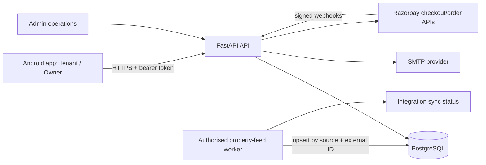
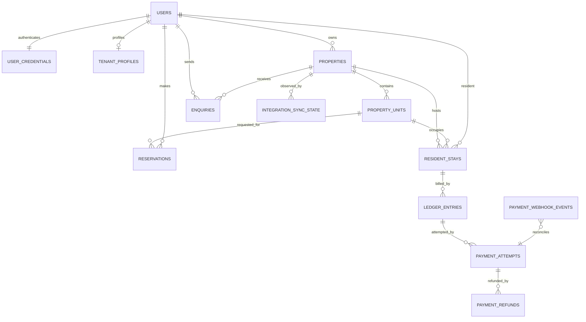
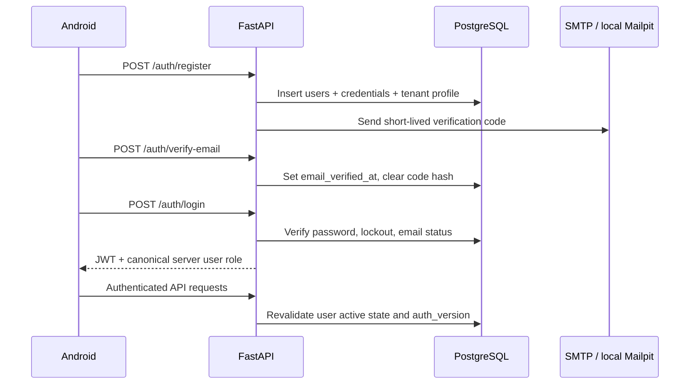
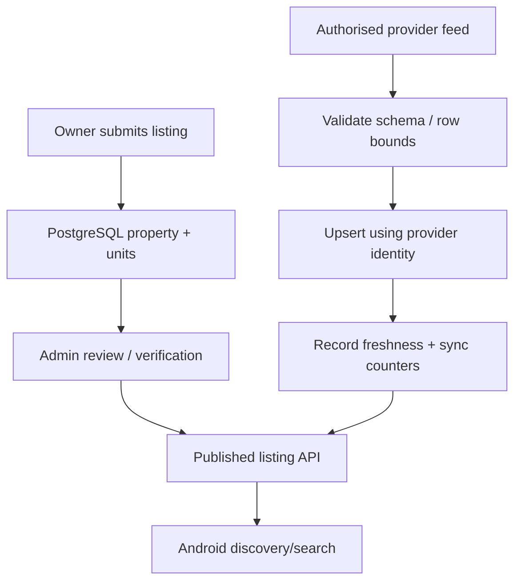

# StayEasy — Backend and Database System Design

**Status:** Current implementation and release gaps, updated 26 October 2026.

## 1. Scope and architecture

StayEasy is an Android client backed by a FastAPI service and PostgreSQL. The Android app is a client, not the source of truth: account identity, role authorization, listing inventory, reservation outcomes, tenant stays and finance state are owned by the server/database.

Local development uses Docker Compose: PostgreSQL + API, Mailpit for captured registration/reset emails, and an optional feed-sync worker. Local Mailpit is only a test inbox; it is not production email delivery. The API port is bound to loopback by default. The Android emulator reaches the host computer at `http://10.0.2.2:8000`.

## 2. Core data model

Entity responsibilities:

| Table / group | Responsibility | Integrity/security rule |
|---|---|---|
| `users` | Canonical identity, active state, server-assigned role | Normalized email; unique account identity |
| `user_credentials` | Scrypt password hash, email verification, failed-login lockout, reset codes, auth-version counter and Owner approval status | No raw password or one-time code stored; expired/revoked sessions rejected |
| `tenant_profiles` | Optional tenant profile and emergency contact fields | One profile per account; removed when account is deleted |
| `properties`, `property_units` | Owner listings and inventory | Unit code unique inside a property; external records use provider/source identity; publication and verification are separate concepts |
| `enquiries`, `visits`, `reservations` | Customer-to-owner discovery and booking intent | API validates role and property scope; PostgreSQL partial unique index prevents concurrent active reservations for the same unit |
| `resident_stays`, `resident_move_out_requests` | Occupancy and move-out workflow | Owner/property scope; one pending move-out request per stay |
| `ledger_entries`, `payment_attempts`, `payment_refunds`, `payment_webhook_events` | Rent/deposit ledger and payment-provider reconciliation | Server-calculated amount, idempotency keys, unique provider IDs and deduplicated signed webhooks |
| `integration_sync_state` | Last property-feed attempt, safe error category and batch counters | Never stores feed credentials, URLs or raw provider payloads |

The SQLAlchemy models are in `backend/app/models.py`; ordered schema changes are in `backend/alembic/versions/`. Do not use `Base.metadata.create_all()` as the production migration mechanism. CI verifies Alembic upgrades against a clean database.

**Important schema caveat:** the ER diagram shows domain relationships; several legacy identifier columns (including `properties.owner_id`, `enquiries.customer_id`, and `reservations.customer_id`) are currently plain IDs rather than declared PostgreSQL foreign keys. Authorization is enforced in the API, but referential integrity is not yet database-enforced for every logical relationship. Before importing production data, run an orphan/duplicate audit, define a backfill policy for legacy/dev-token records, then add staged foreign-key constraints in a dedicated migration. Do not silently auto-create privileged accounts to satisfy missing references.

## 3. Authentication and account lifecycle

1. The mobile role selection chooses a requested workspace; it never sets the effective role.
2. Tenant registration creates a customer account. Owner registration also creates a customer account, but sets `requested_workspace=owner` and `owner_access_status=pending_approval`.
3. Only an authenticated administrator can approve an Owner request. Approval changes the server role, increments `auth_version` to invalidate existing customer sessions, and is audited.
4. The approved account signs in again to receive an Owner-role token.
5. Password reset/logout increment `auth_version`; backend checks current account state on protected requests.
6. SMTP must be configured for registration and recovery codes. Local development sends to Mailpit (host inbox `http://127.0.0.1:8025`); production/staging requires a real secured SMTP relay.

## 4. Rental data flow: authoritative versus test data

There are three distinct data sources; the UI and test reports must not conflate them.

- **Owner-entered records:** created through authenticated Owner APIs and persisted in PostgreSQL. Listing review/publication controls public visibility.
- **Development fixtures:** seeded by `backend/app/seed_demo.py` when `APP_ENV=development` and `SEED_DEMO_DATA=true`. They are synthetic test records, not actual vacant properties.
- **External supply feed:** optional worker `backend/app/feed_ingestion.py`; requires an authorised provider endpoint in `PROPERTY_FEED_URL` and optional `PROPERTY_FEED_TOKEN`. It upserts by `data_source + external_source_key`, records freshness and leaves provider listings unverified. A green sync is not proof that a listing is available; provider freshness and verification must be checked.

Flow:

Before representing data as live, test an approved provider sandbox or feed fixture endpoint end-to-end; record timestamp, source, imported/updated/skipped counts and provider availability status. Do not scrape websites without permission or invent property supply. External provider acceptance is not yet complete in this repository because no authorised production/test feed URL was supplied.

## 5. Environments, testing, and operations

| Environment | Database/data | Email | Payment/feed |
|---|---|---|---|
| Local developer stack | Disposable/local PostgreSQL plus labelled fixtures | Mailpit, no outbound mail | Test credentials only; feed opt-in |
| CI | Disposable PostgreSQL plus isolated contract-test SQLite | Mocked SMTP in tests | No live payment calls or real provider inventory |
| Staging (next gate) | Dedicated PostgreSQL, migrations and controlled test users | Secured SMTP sandbox | Authorised provider feed + Razorpay test mode + HTTPS webhook |
| Production (not approved by CI alone) | Managed PostgreSQL, backups/PITR, migration review and monitoring | Secured SMTP relay | Live keys only after acceptance, reconciliation and legal/operations sign-off |

Current automated checks include API contract tests, migration validation, PostgreSQL reservation concurrency, Docker Compose seeded API smoke tests, Android emulator navigation and APK build. This milestone adds a PostgreSQL-backed registration → email verification → login → Owner approval → listing publication → tenant discovery test.

## 6. Next release gates

- [ ] Run the new account-to-listing test against PostgreSQL CI and retain the green run as evidence.
- [ ] Install the candidate APK and verify signup/verification/login using Mailpit.
- [ ] Provide an authorised external property feed endpoint before claiming real-time external inventory.
- [ ] Execute Razorpay test-mode checkout and signed webhook acceptance in staging; configuration presence alone is not checkout proof.
- [ ] Configure secure signing, production secret management, backup/restore, monitoring, rate limiting, privacy/security review, and real-device acceptance before public release.
